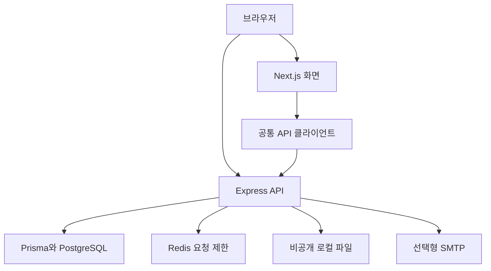
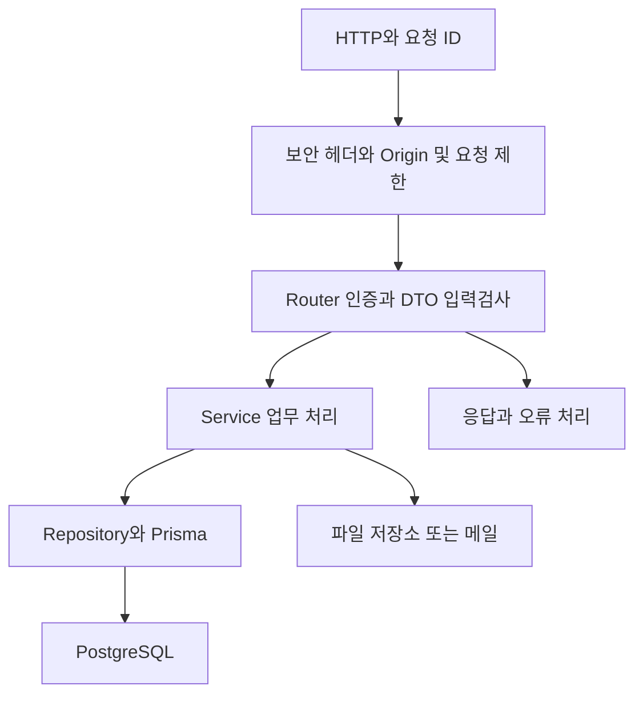
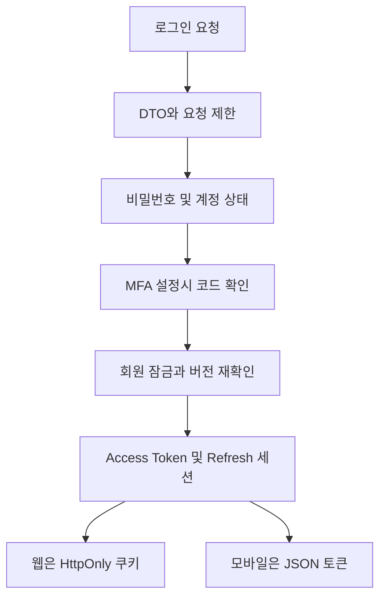
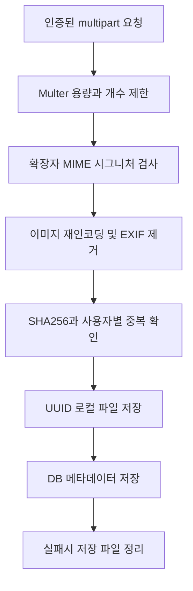
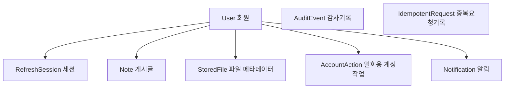
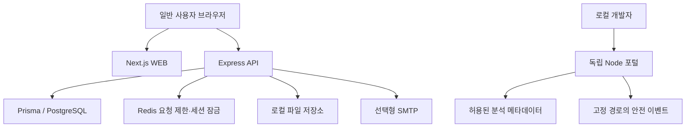
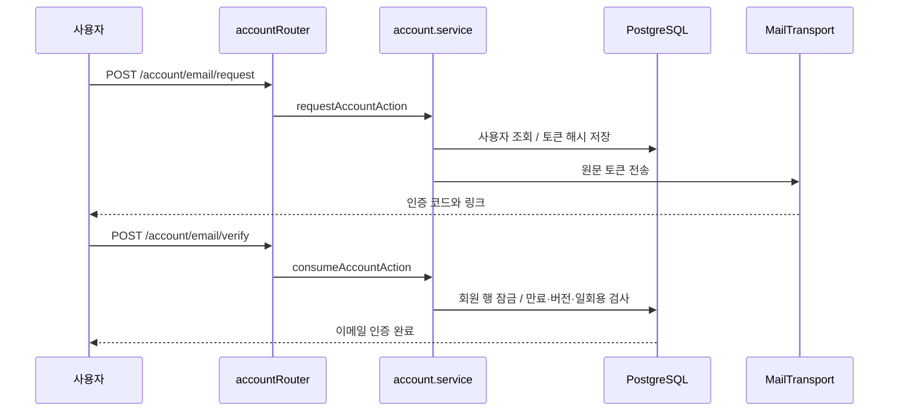
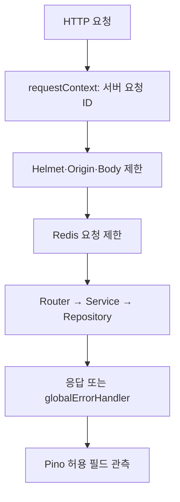

# 전체 구조와 인증·파일 처리 흐름

> **알 수 있는 것:** 시스템 연결, 요청 흐름, DB 관계, 모듈 의존성
>
> **읽을 때:** 코드를 고치기 전 구조를 이해할 때
>
> **관련 기능:** 전체 구조와 인증·파일 처리 흐름
>
> **관련 소스:** [layout.tsx](../../apps/web/src/app/starter/layout.tsx) · [client.ts](../../apps/web/src/shared/api/client.ts) · [app.ts](../../apps/api/src/bootstrap/app.ts) · [schema.prisma](../../apps/api/prisma/schema.prisma)
>
> **관련 문서:** [문서센터](../README.md)

## 이 문서의 목차

- [시스템 구성](#시스템-구성)
- [API와 모듈 의존성](#api와-모듈-의존성)
- [인증 처리](#인증-처리)
- [파일 업로드](#파일-업로드)
- [데이터베이스 관계](#데이터베이스-관계)
- [실제 코드 기반 시스템 구조](#실제-코드-기반-시스템-구조)
- [주요 실행 흐름](#주요-실행-흐름)
- [폴더별 역할과 수정 위치](#폴더별-역할과-수정-위치)

## 시스템 구성

화면은 `apps/web/src/app/starter`, 공통 통신은 `apps/web/src/shared/api`, 서버 진입점은 `apps/api/src/bootstrap/app.ts`입니다. 화면이 브라우저에서 API를 호출하며 Next 서버가 모든 요청을 대신 전달하는 구조는 아닙니다.

## API와 모듈 의존성

DTO는 입력 데이터 모양을 검사하는 규칙입니다. `common`은 인증·오류·응답, `infrastructure`는 DB·Redis·로그 연결입니다. `auth`, `notes`, `files`, `platform` 모듈이 이를 사용합니다. 일부 계정·관리자 라우트는 별도 Repository 없이 Prisma를 직접 호출합니다.

## 인증 처리

`auth.controller.ts` → `auth.service.ts` → `auth.repository.ts`, MFA는 `mfa.ts`입니다. 일반 요청은 `common/auth.middleware.ts`에서 토큰과 계정 버전을 확인합니다. 모바일 앱 자체는 포함하지 않습니다.

## 파일 업로드

PDF는 이미지 재인코딩을 거치지 않습니다. `files.controller.ts`, `files.service.ts`, `image.processing.ts`, `storage/local.storage.ts`를 참고하세요. 파일과 DB는 단일 트랜잭션이 아니며 바이러스 검사는 제공하지 않습니다.

## 데이터베이스 관계

화살표는 User 한 명에서 여러 레코드로 이어지는 실제 외래키 관계입니다. AuditEvent.actorId와 IdempotentRequest.scope는 문자열이며 Prisma 외래키 관계가 없습니다. 파일 바이트는 DB 밖에 저장합니다. 상세 열·인덱스·삭제 규칙은 [DB 스키마](../../apps/api/prisma/schema.prisma)가 기준입니다.

[전체 파일 역할](../07-기술참고/전체-파일색인.md) · [기능 목록](../02-전체기능/전체-기능과-구현근거.md)

## 실제 코드 기반 시스템 구조

수동 작성 다이어그램입니다. 정적 import 탐색은 포털에서 별도로 생성합니다.

포털 서버에는 DB 접속 기능, 원격 URL fetch, shell, SQL, 임의 파일 읽기 API가 없습니다. Dockerfile.api는 apps/api만, Dockerfile.web는 apps/web만 복사합니다. `tools/dev-portal`과 `analysis`는 해당 운영 이미지 COPY 대상에 포함되지 않습니다. 실제 Docker 이미지의 내용 검증은 Docker 부재로 미검증입니다.

포털 그래프는 TypeScript 정적 import 중 최대 36개를 표시합니다. 검색/확대/스크롤/키보드 노드 선택을 제공합니다. 설정 기반 실행, C#→PowerShell, DB 외래키, Redis 키 관계와 함수 호출 순서 전체를 자동으로 복원하지 않습니다. 요청된 16종 전용 아키텍처 맵과 22종 프로세스의 전체 조건 분기 시각화는 미완성입니다.

## 주요 실행 흐름

수동 검토 설명이며, 소스 파일의 함수 이름과 연결합니다. 포털의 선언 목록에는 AST에서 찾은 줄 번호가 제공됩니다.

### 이메일 접근 확인

- [요청 검증 및 엔드포인트](../../apps/api/src/modules/platform/platform.controller.ts)
- [토큰 발행·소비·메일 변경](../../apps/api/src/modules/platform/account.service.ts)
- [SMTP 제공자](../../apps/api/src/modules/platform/smtp.ts)
- [공개 인증·재설정 화면](../../apps/web/src/app/starter/email/page.tsx)
- [격리 계정 테스트](../../tools/test-mail.mts)

실패 시 만료/재사용/버전 불일치는 거부하고, 전송 실패 시 발행한 토큰을 소비 처리합니다. 비밀번호 재설정은 기존 MFA를 해제하지 않습니다. 이메일 형식 검사는 계정 실재 여부 확인이 아닙니다.

### 요청·로그·종료

[API 부트스트랩](../../apps/api/src/bootstrap/app.ts), [안전 종료](../../apps/api/src/bootstrap/server.ts), [실행기 C#](../../tools/SecureStarterLauncher.cs), [PowerShell 수명주기](../../SECURE-LIFECYCLE.ps1).

C# 런처는 자신의 파일명으로 SETUP/STARTER/STOP Action을 선택하고 Windows PowerShell 5.1 프로세스를 기다린 뒤 같은 종료코드를 반환합니다. 실행기 소스는 보존했으며 Windows 런타임 동작은 미검증입니다.

## 폴더별 역할과 수정 위치

| 경로 | 역할 | 수정할 때 |
|---|---|---|
| `apps/web/src/app/starter` | 실제 앱 화면과 탐색 메뉴 | 새 페이지 추가 |
| `apps/web/src/shared` | 공통 UI·통신·인증 도구 | 재사용 동작 수정 |
| `apps/api/src/bootstrap` | Express 구성·헬스체크·종료 | 서버 공통 처리 수정 |
| `apps/api/src/modules` | 인증·게시글·파일·계정·관리자 | 업무 API 추가 |
| `apps/api/src/common` | 인증 검사·응답·입력검사·공통 오류 | API 공통 규칙 수정 |
| `apps/api/src/infrastructure` | Prisma·Redis·요청 제한·로그 | 외부 서비스 연결 수정 |
| `apps/api/prisma` | DB 스키마와 순서대로 적용하는 SQL | 격리 개발 DB에서 변경 |
| `tools/dev-portal` | 개발자 화면·읽기 전용 서버 | 내부 문서·분석 화면 수정 |
| `tools` | 분석·검증·백업·실행기 빌드 | 개발 도구 수정 |
| `deploy` / `compose*.yaml` | Docker 이미지·운영 프록시·서비스 구성 | 배포 설정 수정 |
| `docs` | 모든 현재 안내·기술 참고·이전 기록 | 기능 변경과 함께 갱신 |
| `analysis` | 다시 생성할 수 있는 정적 분석·현재 검증 데이터 | 수동으로 완료 상태를 꾸미지 않기 |
| `verification` | 이전 검증 증거와 이번 문서 검증 로그 | 실행 시점 구분 |
| `backup` | 변경 전 소스·문서 보관 | 새 빈 폴더에 풀어 비교 |

모든 주요 파일의 위치는 [전체 파일색인](../07-기술참고/전체-파일색인.md)에서 찾을 수 있습니다. 포털 파일 분석에서 함수·import·관련 문서·테스트 메타데이터를 확인하세요.
