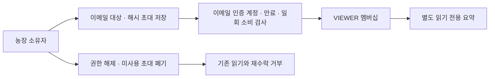

# 4차 운영 안정화·모바일 농업 앱·읽기 공유 검증

작업일: 2026-10-29~30, 한국 시간. 이번 실행은 기능을 실제 확장했지만 **전체 4차 요구사항이나 운영 서비스 완성을 뜻하지 않습니다.** 아래의 완료·부분 완료·외부 대기를 구분합니다. 이전 공통 기반 결과는 당시 기록으로 보존합니다.

## 작업별 현재 상태

| 작업 | 상태 | 실제 범위와 남은 부분 |
|---|---|---|
| DB+업로드 재해복구 | 로컬 검증 완료 | 중지 구간에 암호화 백업·별도 PostgreSQL/저장소 복원·파일 2개 해시/메타데이터·인증 파일 API·타인 차단. 오프사이트·대용량·실제 운영 복구 훈련은 남음 |
| Linux STAGING 준비 | 부분 완료 | 실제 Linux API 이미지 빌드·STAGING 컨테이너 기동·UID 1000·읽기 전용 루트·capability 제거·별도 Redis/복원 DB readiness 통과. 전체 Compose·웹 컨테이너·Caddy·공인 TLS·실제 도메인/클라우드 배포는 미검증 |
| 회원 메일 | 로컬 검증 완료 / 외부 대기 | 기존 인증·재설정·메일 변경·탈퇴/복구와 로컬 SMTP 시험 유지. 외부 받은편지함 수신은 미검증 |
| 장애 알림 | 부분 완료 | API/DB/Redis 상태·백업/배포 실패·복구 사건·중복 억제·확인 시각·시험 outbox. 외부 발송은 기본 비활성. 포털은 조회만, 확인은 로컬 CLI |
| 디스크 부족 | 부분 완료 | 관측 저장소가 있는 파일시스템의 여유 공간 256MiB 미만 감지. 별도 DB·사진 볼륨 및 원격 디스크 개별 감시는 미구현 |
| 부하 | 부분 완료 | 격리 대시보드 동시 4요청·총 20요청, CPU/RAM/RSS/p50/p95/오류 기록. 로그인·사진·대규모 데이터·전체 Redis 미들웨어 부하는 미검증 |
| 대시보드·모바일 메뉴 | 구현 및 검증 완료 | 실제 소유 농장·오늘/예정 작업·최근 일지/사진·센서 측정·작물·읽지 않은 알림. 빈 상태·새로고침·상한 안내. 조회 공유 농장은 별도 화면 |
| 간편 일지·일정 | 구현 및 검증 완료 | 농장·날짜·작업 종류·선택 메모, 일지 저장 후 기존 사진 업로드 재사용. 실패 시 입력 유지·한국어 오류·같은 화면 재시도 키 유지 |
| 회원·소유자 권한 | 기존 기능 검증 유지 | 기존 인증·세션·MFA·탈퇴·관리자 검사 재사용. 플랫폼 관리자가 소유권을 자동 우회하지 않음 |
| 농장 협업 | 부분 완료 | OWNER·VIEWER만 지원. 소유자 초대/목록/해제/취소/감사, 인증된 이메일의 일회·24시간 초대 수락, 별도 읽기 요약. ADMIN/WORKER 쓰기 공유·역할 변경·사진/센서/판매 공유는 미구현 |
| 접근성 | 부분 검증 | 키보드 본문 건너뛰기·명시적 레이블·오류 알림·본문 18px·터치 영역·320/390/768/1280px 가로 넘침·현재 메뉴 확인. WCAG 2.2 AA 인증이나 전수 검사가 아님 |

## 농민이 사용하는 방법

로그인하면 **오늘의 농장**에서 자신의 실제 기록을 확인합니다. 모바일 아래 메뉴는 홈·내 농장·영농일지·일정·알림·더보기입니다. 센서·농사 상담·판매·주문은 농장 상세에서, 계정·공유·파일·게시글·도움말은 더보기에서 사용합니다. 관리자 메뉴는 관리자에게만 노출하며 서버 권한 검사도 유지합니다.

영농일지는 **영농일지 → 농장 선택 → 작업한 날 → 작업 종류 → 메모(선택) → 저장** 순서입니다. 메모를 생략하면 작업 종류를 내용으로 저장합니다. 성공 뒤 사진 등록·조회를 열면 기존 파일 업로드/일지 연결 기능을 그대로 사용합니다. 일정도 같은 방식으로 만들고 농장 상세에서 완료 처리합니다. ‘작기’는 작물을 언제 심고 거두는 한 차례의 재배 기간을 뜻합니다.

저장 중 버튼을 잠그며, 오류가 나면 입력과 재시도 키를 유지합니다. 같은 화면·같은 내용을 재전송하면 서버의 기존 IdempotentRequest와 농장 행 잠금으로 같은 결과를 돌려줍니다. 내용을 바꾸거나 화면을 닫으면 새 요청이므로 저장 여부를 먼저 확인합니다. 기기 재시작까지 보존하는 오프라인 작성함은 미구현입니다. 대시보드는 농장 20곳·작업/작물 최근 200건·센서 100개·일지/사진/알림 최근 5건으로 제한하고 이 한계를 화면에 표시합니다.

## 읽기 전용 초대와 접근 제한

**더보기 → 함께 보는 농장·구성원**에서 소유 농장을 고르고 상대 이메일로 초대를 만듭니다. 현재는 읽기 전용만 선택할 수 있습니다. 코드는 한 번만 표시하며 안전한 수단으로 직접 전달합니다. 외부 초대 메일을 보냈다고 표시하지 않습니다. 수락자는 해당 이메일로 로그인하고 실제 이메일 인증을 마친 뒤 코드를 입력합니다.

- 토큰은 32바이트 난수이며 DB에는 SHA-256 해시만 저장합니다. 만료 24시간·한 번 사용·이메일 일치·계정 인증·농장/소유 계정 활성 상태를 검사합니다.
- 같은 이메일에 새 초대를 만들면 이전 미사용 초대는 폐기합니다. 초대 취소·멤버 해제는 소유자만 할 수 있습니다. 해제 시 그 이메일의 남아 있는 미사용 초대도 함께 폐기합니다.
- VIEWER는 별도 `/workspace/shared/:id`에서 이름·작물·최근 일지 글·작물/일정만 읽습니다. 기존 소유자용 API의 쓰기 권한을 완화하지 않았습니다. 위치·사진 파일·장치 키·판매·결제·계정 정보는 이 공유 응답에 포함하지 않습니다. 일지 자유 텍스트에 개인정보를 적지 않아야 합니다.
- 요청 본문에 OWNER 등의 역할을 주입하면 거부합니다. 동시 수락은 한 번만 성공합니다. 해제 뒤 기존 토큰으로 읽기 및 미사용 초대 재수락을 거부합니다.
- 플랫폼 관리자는 일반 농장 API에서 소유권을 우회하지 않습니다. ADMIN/WORKER 역할과 구성원 쓰기 권한, 역할 변경 UI는 다음 단계입니다.
- 계정 내보내기에 자신의 멤버십과 관련 초대 메타데이터를 추가했고, 비밀번호·초대 토큰 원문/해시는 제외합니다.



## 구현 파일·API·DB

| 기능 | 실제 파일 | API·DB |
|---|---|---|
| 농장 통합 요약·초대·공유 | [workspace.controller.ts](../../apps/api/src/modules/farms/workspace.controller.ts) | `/api/v1/workspace/dashboard`, `/farms/:id/members`, `/farms/:id/invitations`, `/invitations/accept`, `/shared`, `/shared/:id`. 나머지 경로도 workspace 접두사 사용 |
| 역할·초대 DB | [Prisma](../../apps/api/prisma/schema.prisma), [추가 SQL](../../apps/api/prisma/migrations/20261029130000_farm_readonly_members/migration.sql) | FarmMember·FarmInvitation 추가. 기존 20개 테이블/열 삭제 없음. 역할 CHECK는 VIEWER만 허용 |
| 일지/작업 중복 방지 | [farm-idempotency.ts](../../apps/api/src/modules/farms/farm-idempotency.ts) | 기존 일지 POST·records POST의 선택 Idempotency-Key 헤더. 같은 키/다른 본문 409, 잘못된 키 400. 소유권 검사 뒤 트랜잭션 안에서 처리 |
| 대시보드 | [FarmDashboard.tsx](../../apps/web/src/app/starter/_components/FarmDashboard.tsx) | 실제 API에만 연결, 임의 AI/센서 자료 생성 없음 |
| 간편 입력 | [FieldWorkbench.tsx](../../apps/web/src/app/starter/_components/FieldWorkbench.tsx), 기존 DiaryPhotos | `/starter/diary`, `/starter/schedule` |
| 구성원 화면 | [members/page.tsx](../../apps/web/src/app/starter/members/page.tsx) | `/starter/members` |
| 공통 메뉴·스타일 | [Shell.tsx](../../apps/web/src/app/starter/_components/Shell.tsx), [starter.css](../../apps/web/src/app/starter/starter.css) | 로그인 상태에 따른 반응형 6메뉴·본문 바로가기·큰 조작 영역 |
| 사건 이력 | [incidents.mjs](../../tools/monitoring/incidents.mjs), 기존 collector/core/monitor-view | 환경별 incidents.json, 접근키 보호 포털 GET `/incidents?environment=LOCAL` |

## DB와 사진을 함께 복구하는 절차

실제 훈련 도구는 [verify-farm-postgres.mjs](../../tools/verify-farm-postgres.mjs), 파일 API 검사는 [verify-restored-files.mts](../../tools/verify-restored-files.mts)입니다. DB·복호화 키 값을 문서나 로그에 출력하지 않습니다.

1. 런처 STOP으로 API·작업자를 중지합니다. 다른 직접 쓰기 작업도 멈춰야 합니다. DB/Redis 컨테이너만 원래 ID로 시작하고 API 정지(ECONNREFUSED)를 확인합니다.
2. 일반 파일만 읽고 링크·하드링크·100MiB 초과 업로드를 거부합니다. DB custom dump와 파일을 기존 인증 암호화 포맷으로 한 백업에 저장합니다.
3. 별도 `ct_farm_verify_...` DB와 `verification/runtime/restore-...` 저장소에 복원합니다. 기존 열 지문·스키마·파일 크기/해시·활성 파일 메타데이터를 검사합니다.
4. 합성 인증키와 별도 Redis의 실제 파일 API로 복원 파일을 읽어 바이트 해시를 비교하고 다른 사용자 요청 404를 확인합니다. 원본 사용자 비밀번호는 사용하지 않습니다.
5. 모든 검증이 성공한 뒤에만 기존 DB에 추가 테이블을 적용했고 원본 지문을 다시 확인했습니다. 실패한 시도는 원본 적용 전에 중단했습니다. 복구 DB·기존 볼륨을 reset/삭제하지 않았습니다.

이번 DB+파일 증거는 `verification/ct-farm-round4-migration.json`입니다. 백업은 `backup/ct-farm-postgres-1793279076249.ssbk`, 복원 파일 2개·API 허용 2개·타인 거부 2개, 기존 20개 테이블 지문 보존입니다. 기본 복원 구간 8.8초·전체 명령 26.551초는 **로컬 훈련 시간**이며 운영 장애 전체 RTO가 아닙니다. 유지보수 중 도구 수정·대기는 이 수치에 포함하지 않습니다. 쓰기 중지 시점의 DB/파일 일관성 검증이며 운영 RPO 계약·오프사이트 복제·Windows ACL·대용량 복원은 추가 검증이 필요합니다. 원본에 복원본을 덮어쓴 시험은 하지 않았습니다.

복호화 키는 별도 안전한 저장소에 보관하고 [기존 복구 안내](../05-운영과보안/배포와-백업복구.md)를 따릅니다. 소스 복구는 변경 전 ZIP을 별도 폴더에 풀어 필요한 파일만 비교 적용합니다. 소스 롤백을 이유로 추가 테이블을 삭제하지 않습니다.

## Linux·HTTPS·외부 메일 준비

기존 deploy/Dockerfile.api·compose.server.yaml·Caddyfile·STAGING 환경 예시를 재사용합니다. Docker API 빌드의 npm 설치에 요청 시간 제한·재시도 한도를 추가했습니다. 초기 설치 지연으로 중단한 시도와 재시도 성공을 구분합니다. 실제 Linux 이미지 `ct-farm-round4-api:local`의 로컬 컨테이너가 STAGING·UID 1000·읽기 전용 루트·capability 제거 상태로 별도 Redis/복원 DB readiness를 통과했습니다. [시험 도구](../../tools/verify-linux-api.mjs)와 `verification/ct-farm-round4-linux.json`이 근거입니다.

이는 실제 도메인 발급·공인 인증서·클라우드 배포가 아닙니다. 전체 웹 이미지/Compose 배포, Caddy HTTPS, HTTPS 쿠키/CORS, 로그인 세션, 실제 장애 롤백과 운영 승인 검증은 외부 환경에서 이어갑니다. 실제 값을 기존 deploy/staging.env.example에 대응하는 비공개 환경 설정으로 준비하되 운영 DB·키를 재사용하지 않습니다. 공인 도메인과 서버가 없으므로 임의로 만들거나 배포하지 않았습니다.

회원 인증·재설정 메일은 기존 Nodemailer 구조를 유지합니다. 계정 통합은 MemoryMailTransport, SMTP는 로컬 TCP 수신기로 검증했습니다. 브라우저의 초대 수락 후 흐름만 확인하기 위해 합성 계정의 이메일 인증 상태를 **격리 DB fixture로 설정**했습니다. 실제 외부 이메일 전달·인증 성공으로 계산하지 않습니다.

## 장애·복구 알림과 확인

collector가 API/웹/DB/Redis 건강 상태와 관측 저장소 디스크를 읽습니다. 기존 backup/deploy 이벤트의 실패와 후속 성공을 사건 이력으로 처리합니다. 한 장애가 계속되는 동안 새 알림을 반복 생성하지 않고 복구 때 한 번 전환합니다. 테스트 모드 outbox는 실제 발송 성공이 아닙니다. `MONITOR_ALERT_MODE=TEST`만 시험 기록을 남기고 기본 외부 발송 상태는 NOT_CONFIGURED입니다.

기존 개발 포털의 운영 모니터링에서 **현재 포털 서버의 로컬 사건 이력**·발생/복구·확인 상태를 읽습니다. 원격 hub 사건 동기화와 운영자 웹 처리 버튼은 미구현입니다. 확인 처리는 로컬 운영자 권한으로 환경을 지정한 CLI를 사용합니다.

```powershell
$env:APP_ENV='LOCAL'
node tools/monitoring/incidents.mjs list
# 실제 출력의 사건 UUID로 바꾸어 확인 처리합니다.
node tools/monitoring/incidents.mjs ack 사건_UUID
```

상태 파일은 최대 300개 사건·시험 outbox를 보존합니다. 다중 수집기 동시 쓰기·장기 보존·외부 SMTP/메신저 수신·백업 훈련 도구의 모든 실패 경로 연결은 남은 작업입니다. DB가 내려가도 로컬 파일 이력은 만들 수 있지만 실제 외부 전달을 보장하지 않습니다.

## 부하·접근성·브라우저 검증

`verification/ct-farm-round4-performance.json`에 환경 CPU·RAM·연결 제한·동시성·지연·오류·시험 프로세스 RSS를 기록합니다. 동시 4개·20요청의 **대시보드 읽기만** 검사했습니다. 전체 로그인/사진/센서 부하·모바일 로딩·장시간 메모리·실제 운영 DB 풀 시험으로 해석하지 않습니다.

합성 계정·농장·사진은 복원 DB/격리 업로드에만 만들었습니다. 브라우저에서 가입→로그인→농장→일지→사진→일정→대시보드→초대 생성→미인증 차단→인증 fixture 수락→공유 읽기→권한 해제→알림→로그아웃을 확인했습니다. localhost 쿠키가 포트 사이에 공유되는 점을 발견해 QA를 127.0.0.1 호스트로 분리하고 복원 DB의 기존 refresh 세션을 폐기했습니다. 최초 localhost 시험의 영향으로 기존 브라우저 화면은 다시 로그인해야 할 수 있으나 원본 계정/DB 세션을 시험으로 수정하지 않았습니다.

320/390/768/1280px에서 가로 넘침 없음·본문 18px·단일 본문 h1·실제 사진 로딩을 확인했습니다. 최종 모바일 탭은 58px이며 현재 메뉴는 aria-current와 시각 표시를 함께 제공합니다. 키보드 본문 바로가기의 실제 focus 이동, 이메일 미인증 오류 안내, QA API 중단 시 한국어 오류와 메모 보존을 검증했습니다. 스크린리더 전수·색상 전체 자동 검사·실제 200% 확대·느린 네트워크·모든 화면/기기 조합은 미검증이므로 WCAG 2.2 AA 완료로 표시하지 않습니다.

## 다음 실행 순서

1. ADMIN/WORKER 역할별 capability·모든 쓰기 API/파일 공유 권한·동시 해제·역할 변경을 설계하고 별도 확장합니다. 기존 소유자 검사를 일괄 제거하지 않습니다.
2. 실제 STAGING의 웹+프록시·공인 HTTPS·세션·롤백·비밀 회전을 확인합니다. 운영 배포는 별도 사용자 승인이 필요합니다.
3. 외부 SMTP/온콜 어댑터와 운영자 처리 UI, 원격 사건 동기화·다중 수집기·보존을 완성합니다.
4. 대용량/오프사이트 복구, 로그인·업로드·센서 포함 전체 부하, WCAG 2.2 AA 자동/보조기술/확대·저속망을 검증합니다.
5. 오프라인 작성함·재시도 키의 재접속 보존과 목록의 대용량 페이지 이동을 개선합니다.

[문서센터](시작.md) · [공통 기반](공통기반-검증.md) · [개발현황](../CT-Farm-개발현황.md)
