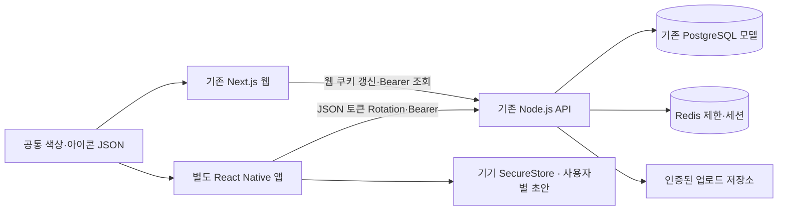

# CT-Farm 모바일 앱 설치·새 화면·실제 검증 안내

기준일: 2026-10-30. **부분 완료입니다. Android USB 시험 APK를 실제 빌드·서명 확인·갤럭시 설치·실행했고 사용자가 로그인 화면 표시를 확인했습니다.** 실제 기기의 가입·카메라·저장·세션·전체 접근성 시나리오는 아직 검증 완료가 아닙니다. 웹을 WebView로 감싼 앱이 아닙니다. 과거 단계의 완료 보고를 이번 실행 결과로 재사용하지 않습니다.

## 무엇이 달라졌나요?

웹은 홈 / 내 농장 / 영농일지 / 일정 / 전체의 5개 주 메뉴를 사용합니다. 알림은 상단 종 모양 버튼과 전체 메뉴에서 접근합니다. 데스크톱은 왼쪽 메뉴, 좁은 화면은 하단 메뉴입니다. 기존 음성 비서·간편 양식·농장 상세·파일·관리자 경로는 유지합니다. 홈의 첫 작업은 말로 기록하기이며 사진·간편 작성도 제공합니다.

홈은 실제 농장·일정·알림·일지·사진·센서·작물 API를 읽습니다. 날씨가 미설정이면 설정 안내를, 자료가 없으면 빈 상태를 보여줍니다. 농장 도우미는 현재 `rules-v1`이며 일정·재배 이력·센서 임계값을 근거로 안내합니다. 생성형 AI 진단이나 농약 처방이라고 표시하지 않습니다. 등록한 농장 화면에서는 긴 등록 양식을 기본으로 펼치지 않고 ‘새 농장 등록’으로 엽니다.

## 모바일에서 사용할 수 있는 범위

아래 ‘검증’은 **앱의 실제 통신/저장 코어를 실행한 HTTP·네이티브 DB 시험**입니다. 사람이 설치한 앱의 화면을 직접 조작했다는 의미가 아닙니다.

| 기능 | 모바일 구현 / 연결 | 검증과 남은 부분 |
|---|---|---|
| 회원가입·로그인·보안 코드 | `/auth/mobile/register`, `/login`, `/refresh`, `/logout`, `/auth/me` | 실제 서버·Rotation·만료·로그아웃 검사. 기기 SecureStore·생체·장기 백그라운드는 미검증 |
| 홈 | `/workspace/dashboard` | 실제 자료·빈/오류 상태. 화면 조작·모바일 레이아웃 실측 미검증 |
| 농장 | 페이지당 20개 목록, 등록·수정·보관 | 소유자 권한·생성 멱등·타인 ID 거부 검사. 주소/좌표는 직접 입력. GPS 자동 입력·앱 지도 위치 선택 미구현 |
| 필지 | 경계·면적 목록과 SVG 개략도 | 서버 등록·좌표 자료 조회 검사. 앱 경계 등록/수정·네이버 지도 미연결, 기존 웹 이용 |
| 작물·재배 | 작물/품종·재배 시작·수확 예정·수정·보관 | 실제 CROP API와 연결. 앱 필지 선택 편집·전체 성장 단계 UI는 추가 필요 |
| 영농일지 | 작업 선택·날짜·메모·카메라/갤러리·저장·조회·수정·보관 | 저장·버전 충돌·사진 업로드/연결/인증 썸네일·타인 차단 검사. 카메라/갤러리 실제 권한은 미검증 |
| 일정 | 작성·예정/완료 조회·수정·완료 표시 | TASK 저장·완료 검사. 달력 격자와 OS 푸시 알림은 미구현 |
| 농장 도우미 | 날씨·근거·위험/할 일·확인 후 일정 추가 | 날씨 미설정 503·규칙 엔진 상태 검사. 실제 공급자·추가 일정 UI 조작은 미검증 |
| 센서 | 실제 센서 상태·측정값 조회, 시험 센서 표시 | 조회 연결. 앱 장치 등록/키 관리·원격 제어는 제공하지 않음 |
| 상품·주문 | 상품 등록·재고/주문 조회·수기 주문·완료/취소 | 생성/주문 멱등·재고·취소 복구 검사. 상품 편집·장부·수확량 전체 UI는 기존 웹 이용. 실결제 미실행 |
| 공유·협업 | 기존 VIEWER 농장/일지 읽기 | 서버 정책 유지. ADMIN/WORKER 확장·배정/보고의 네이티브 UI는 미구현. 원본 협업 활성화 안 함 |
| 음성·계정·운영 | 기존 웹 기능 유지 | 앱 마이크/음성 질문·회원정보/탈퇴·관리자 화면은 아직 이식하지 않음 |

사진은 JPEG로 변환해 첨부하며 원본 갤러리 파일을 덮어쓰지 않습니다. 이미 저장한 일지 ID·업로드 파일 ID를 초안에 남겨 사진 연결만 재시도합니다. 업로드 응답 자체가 유실되면 연결되지 않은 비공개 파일이 남을 수 있으므로 전체 파일 정리 정책은 추가 검증 대상입니다. 성공 응답 전에는 저장 성공을 표시하지 않습니다.

## 디자인과 접근성

[공통 토큰](../../packages/design-tokens/tokens.json)과 [아이콘 경로](../../packages/design-tokens/icons.json)가 원본입니다. 색은 뉴트럴/화이트·절제된 그린, 기본 본문 18, 주요 버튼 높이 56, 카드 반경 22를 사용합니다. 네이티브는 시스템 밝은/어두운 모드를 지원하는 색 구조를 사용합니다. 웹의 자동 다크모드 완성은 아직 아닙니다.

웹은 아이콘+한글 메뉴, 현재 메뉴 표시, 본문 바로가기, 초점 표시, 스켈레톤·빈/오류·재시도를 제공합니다. `prefers-reduced-motion`이면 전환/스켈레톤 애니메이션을 멈춥니다. 브라우저 확대를 제한하지 않습니다. 앱은 글자 배율을 막지 않고 SafeArea·키보드 회피·큰 선택 버튼을 제공합니다. **토큰의 주요 문자/버튼 대비 계산 통과가 WCAG 2.2 AA 전체 충족을 뜻하지 않습니다.** 실제 스크린리더·키보드·좁은 화면·확대·저속망 검사는 미검증입니다.

## 갤럭시 USB 시험 앱

2026-10-30 19:43 KST 설치 완료. 시험 APK `artifacts/CT-Farm-Android-USB-Test.apk`는 약 92MiB이며 SHA-256은 `80272d5c25b6f015d136957b3d53a37f01f750f1810375be0b404b2287f9d161`입니다. 갤럭시 SM-S928N(Android 16·arm64)에 새 패키지로 설치했고, USB 서버 연결·실행 요청과 사용자의 로그인 화면 확인을 구분해 기록했습니다. 사용자 기기 번호와 가입 정보는 보고서에 넣지 않습니다.

PC와 갤럭시를 데이터 전송이 가능한 USB 케이블로 연결합니다. 휴대폰에서 설정 → 휴대전화 정보 → 소프트웨어 정보 → 빌드번호를 7회 누른 뒤, 개발자 옵션의 USB 디버깅을 켭니다. 휴대폰에 표시되는 PC 연결 허용은 사용자가 직접 확인합니다. 기기 식별번호는 공개 보고서에 남기지 않습니다.

이번 시험은 별도 이름 **CT-Farm 시험**, 패키지 `kr.ctfarm.mobile.phonetest`를 사용합니다. 기존 앱이 같은 패키지로 설치되어 있으면 자동으로 덮어쓰지 않습니다. Android 7 이상·arm64 기기를 대상으로 합니다. 시험 APK는 개발용이며 **PC의 Metro와 격리 API가 실행 중이어야 합니다.** PC 없이 독립 실행하는 배포판이나 스토어 등록본이 아닙니다.

프로젝트 전용 SDK는 `.starter-state/phone-test/sdk`입니다. 공식 SDK 도구 SHA-256을 확인하고 기존에 수락된 라이선스 파일만 재사용했습니다. 새 약관 자동 동의·시스템 SDK 교체는 하지 않았습니다. SDK 37의 실제 저장소 이름은 `platforms;android-37.0`입니다. 최초 `android-37` 설치 실패와 수정 후 성공 로그를 모두 보존합니다.

아래 도구는 프로젝트 루트에서 실행합니다. 빌드는 시간이 오래 걸리고 디스크 여유 공간이 필요합니다. 기존 3000/4000 서버와 원본 DB는 제어하지 않습니다.

```powershell
node tools/build-phone-apk.mjs
node tools/start-phone-services.mjs
node tools/phone-device.mjs
node tools/phone-device.mjs --install --connect
node tools/phone-device.mjs --launch
```

- `build-phone-apk.mjs`: 별도 소스 사본에서 APK 생성·서명 확인. 결과 `artifacts/CT-Farm-Android-USB-Test.apk`.
- `start-phone-services.mjs`: 별도 네이티브 PostgreSQL·Redis·업로드에서 HTTP 회귀 검사를 통과한 뒤 임시 API와 localhost Metro 18081 시작. 시험 환경은 최대 2시간이며 종료 후 시험 데이터는 사라집니다.
- `phone-device.mjs`: 연결된 실제 기기 수만 공개합니다. 설치 시 APK 해시·실제 패키지·기존 앱 유무를 확인합니다. `--connect`는 USB로 휴대폰 4084/18081을 시험 API/Metro에 연결하며 기존 연결을 덮어쓰지 않습니다.
- 앱에서는 **시험용 이메일·비밀번호로 새 회원가입**합니다. 기존 계정·실제 농장 개인정보를 넣지 마세요. 본인 PC의 USB 연결을 해제하면 이 방식의 서버 연결도 끊깁니다.
- 시험 API를 종료하려면 `node tools/stop-phone-qa.mjs`를 실행합니다. 이번 실행의 표식을 검증한 뒤 정상 종료 요청만 남깁니다. 다른 컨테이너나 Node 프로세스 전체 종료 명령을 쓰지 않습니다.

원시 SDK·빌드·서비스·기기 결과는 `verification/ui-mobile/phone-sdk`, `phone-build`, `phone-services`, `phone-device`에 있습니다. APK 생성·설치·실제 화면 조작은 각각 별도 결과로 판정합니다. 의존성 보안 경고가 남아 있어 운영 배포 용도로 사용하지 않습니다.

Windows의 긴 중간 경로로 빌드 3회가 실패한 뒤, 전용 Ninja 1.13.2 해시 검증·CMake object 경로 해시(library 230/app 250)·소유 표식이 있는 `.starter-state/pcx/a`의 짧은 앱 중간 경로로 수정했습니다. 최종 `--resume-native` 빌드는 3분 53초·종료 코드 0, 서명 검사도 0입니다. 원래 레지스트리/SDK/소스 의존성 버전은 바꾸지 않았습니다. 참고: [Reanimated Windows 안내](https://docs.swmansion.com/react-native-reanimated/docs/guides/building-on-windows/), [CMake 경로 해시 설정](https://cmake.org/cmake/help/latest/variable/CMAKE_OBJECT_PATH_MAX.html).

추가 APK 검사는 실제 바이너리의 패키지·minSdk 24·targetSdk 36·arm64·마이크 권한 제외·allowBackup=false를 확인했습니다. AAPT 37의 출력 형식(`minSdkVersion`, boolean `false`)을 구형 형식으로 가정한 검사 도구 실패 2회도 보존하고 수정 후 통과했습니다. 캡처 시 전면 앱 확인이 되지 않아 화면 사진은 저장하지 않았습니다. 로그인 화면은 사용자 직접 확인이며 자동 UI 검사 증거와 구분합니다.

## 앱 실행 준비

Expo SDK 58.0.21 / React Native 0.88.1 / React 19.3.0을 모바일 폴더의 별도 잠금 파일로 설치합니다. Node 24.3 이상 호환 버전을 사용하세요(이번 검사 24.22.1). 웹 React 19.3.1과 Next는 유지했습니다. 루트 `workspaces`에 모바일을 강제로 합쳐 의존성을 바꾸지 않았습니다.

PowerShell 5.1 예시:

```powershell
Set-Location -LiteralPath C:\workspace\CT-Farm\apps\mobile
npm ci --workspaces=false
if (!(Test-Path -LiteralPath .env.local)) {
    Copy-Item -LiteralPath .env.example -Destination .env.local
}
```

편집기로 `.env.local`의 `EXPO_PUBLIC_API_URL`을 설정합니다. 이 값은 앱에 공개되므로 비밀번호·공급자 키·토큰을 넣지 마세요. 기본 예약 도메인 `staging.example.invalid`는 의도적으로 연결되지 않습니다.

| 실행 대상 | API 주소 예 | 주의 |
|---|---|---|
| Android 에뮬레이터 | `http://10.0.2.2:시험포트/api/v1` | 개발 빌드 전용. Windows 127.0.0.1의 별도 시험 서버에 연결 |
| USB 실제 Android | adb reverse로 연결한 시험 포트 | 선택한 시험 장치에서만 수동 구성. 실제 검사 미실행 |
| 실제 Android/iPhone | 기기에서 접근 가능한 STAGING HTTPS `/api/v1` | 휴대폰의 localhost는 PC가 아님. 공인 인증서·서버/방화벽 준비 필요 |
| 배포 빌드 | HTTPS 주소 | 앱 클라이언트는 공개 HTTP를 허용하지 않음 |

기존 4000 원본 DB에 합성/부하 시험을 하지 마세요. [격리 API 시나리오 도구](../../tools/test-mobile-api.mts)는 새 컨테이너·DB·Redis·업로드를 만들고 종료 시 이번 자원만 정리합니다. 사용자 원본 계정을 쓰지 않습니다. 현재 이 도구는 자동 HTTP 검사이며 기기용 상시 체험 서버가 아닙니다.

설정 후 개발 빌드가 설치돼 있는 기기/에뮬레이터에서:

```powershell
Set-Location -LiteralPath C:\workspace\CT-Farm\apps\mobile
npm start
```

처음에는 개발 빌드 설치가 먼저 필요합니다. 개발 서버는 아래 의존성 위험 때문에 기본 localhost로 제한합니다. Android USB 시험에는 선택한 시험 장치의 Metro 포트 reverse 등이 필요하며 실제 구성은 미검증입니다. Expo Go의 SDK 58 호환을 보장하지 않습니다. 계정/프로젝트 없는 상태에서 `eas build`를 자동 실행하거나 유료 자원을 만들지 않았습니다.

모노레포 밖에서 전달할 때는 [독립 모바일 소스 ZIP](../../artifacts/ct-farm-mobile-source-20261030.zip)을 사용합니다. **앱 설치 파일이 아닙니다.** 앱/공개 디자인 토큰/잠금 파일만 allowlist로 묶었고 환경파일·기존 DB·업로드·서명 키는 포함하지 않았습니다. `.env.example`은 예약 도메인만 가진 공개 예시입니다. 원본 앱은 공통 토큰을 직접 참조하고, ZIP은 생성한 토큰 사본을 포함해 별도 폴더에서도 참조가 해결됩니다. 이 독립 폴더의 Android JS 번들도 실제 검사했습니다. 새 PC에서의 완전한 재설치·네이티브 빌드·원격 EAS 업로드는 별도입니다. EAS를 사용할 때 원본 저장소 전체/환경파일을 전송하지 말고 이 소스 범위와 서명 설정을 먼저 검토하세요.

## Android 개발 빌드와 현재 막힌 조건

초기 Windows 기본 SDK는 플랫폼 34라서 [빌드 환경 검사](../../tools/mobile-build-doctor.mjs)가 종료 코드 **2**를 기록했습니다. 이후 시스템 SDK를 유지하고 전용 경로에 **플랫폼 37.0, Build-tools 37.0.0, NDK 27.1.12297006**을 준비해 doctor **0**, 실제 Gradle APK 컴파일·서명·갤럭시 설치를 통과했습니다. 에뮬레이터·iOS 네이티브 빌드는 미실행입니다. 새 라이선스를 자동 수락하지 않았습니다.

Android Studio SDK Manager에서 필요한 구성요소를 사용자가 준비한 뒤 다음을 실행할 수 있습니다:

```powershell
Set-Location -LiteralPath C:\workspace\CT-Farm\apps\mobile
# JAVA_HOME, ANDROID_HOME은 해당 PC의 실제 설치 경로를 사용합니다.
npm run android
```

`expo prebuild --platform android --no-install`은 실제로 통과했습니다. 생성한 Android 프로젝트에는 SecureStore 백업 제외, 앱 백업 비활성, 마이크 권한 제거 지시가 있으며 실제 시험 APK에서도 마이크 권한 없음·allowBackup=false를 확인했습니다. debug에서만 개발 HTTP가 허용되며 release API 검사는 HTTPS입니다. 커스텀 플러그인은 release가 기본 debug 키로 서명되는 것을 제거합니다. 운영 키·EAS 서명 주입·스토어 배포는 별도 검증이 필요합니다. 개발 키로 운영 배포하지 마세요.

## iPhone 실행과 TestFlight

iOS JavaScript 번들 생성은 통과했습니다. Windows에는 Xcode가 없어 iOS 네이티브 바이너리/시뮬레이터를 빌드하지 못했습니다. Mac에서 Xcode·호환 iOS SDK를 준비한 후 동일 모바일 폴더에서 `npm ci --workspaces=false`, `npm run ios`로 로컬 개발 빌드를 검증합니다. 실제 기기 서명 방식과 계정을 먼저 확인하세요.

EAS 실제 iPhone 개발 빌드/Ad Hoc·TestFlight에는 Expo 프로젝트/계정과 Apple Developer·서명/기기 등록 또는 App Store Connect 준비가 필요합니다. [eas.json](../../apps/mobile/eas.json)은 development/preview/production 구성을 제공하지만 원격 빌드를 실행하거나 서명 성공을 검증한 것은 아닙니다. `kr.ctfarm.mobile`은 현재 소스의 식별자이며 스토어 소유권/가용성을 확인한 값이 아닙니다.

## 로그인·개인정보·안전한 재시도

- access token은 메모리에만, refresh token과 사용자 ID는 Expo SecureStore에 보관합니다. 웹 쿠키 인증을 복사하지 않고 기존 `/auth/mobile/*` JSON Rotation을 사용합니다. `credentials: omit`이며 Authorization은 지정 API에만 전송합니다.
- 동시 refresh를 공유하고 401만 만료로 정리합니다. 429의 대기 시간 동안 추가 갱신을 막고 네트워크 장애에는 초안을 지우지 않습니다. 헤더/본문을 포함한 요청 제한은 15초입니다. 변경 요청을 자동 재전송하지 않습니다.
- 일지/일정 초안은 사용자별 보안 저장소에 24시간 유지합니다. 앱 재실행 복원·계정 전환·로그아웃·만료 정리와 쓰기/정리 경쟁을 코어 시험으로 확인했습니다. 기기 저장소 용량/잠금/실패·실제 새로 실행은 미검증입니다. 저장소 오류 시 안내하며 저장 전 재시도 키 보관 실패를 성공으로 처리하지 않습니다.
- 일지/일정은 같은 키와 본문으로 수동 재시도합니다. 농장/상품 생성도 기존 IdempotentRequest 테이블을 사용하도록 보강했습니다. 요청 키가 없는 기존 웹/API 호출은 호환됩니다. 추가 migration은 없습니다. 농장 생성은 계정 행 잠금, 상품/일지는 농장 행 잠금으로 검사합니다.
- 소유자 API를 넓히지 않았습니다. 공동 농장의 사진·위치·판매·장치 키가 자동 공유되지 않습니다. 파일은 인증한 썸네일을 메모리 이미지로 표시하며 토큰을 URL에 넣지 않습니다.
- 계정 전환 때 늦은 응답을 버리고, 다단계 저장은 시작한 세션에 바인딩합니다. 오프라인 로그아웃은 기기 정보를 정리하지만 원격 해제 확인이 안 됐다는 안내를 남깁니다.

## 소스·API·데이터 영향



| 변경 영역 | 실제 파일 | API/테이블/영향 |
|---|---|---|
| 웹 구조·홈·전체·알림 | `Shell.tsx`, `FarmerHome.tsx`, `more/page.tsx`, `notifications/page.tsx`, `app-ui.css` | 기존 workspace·farm·notifications 사용. 관리자/개발자 API 유지 |
| 공통 디자인 | `packages/design-tokens/`, `tools/build-design-tokens.mjs` | 웹 CSS/아이콘 생성, 네이티브 JSON 공유. DB 없음 |
| 네이티브 앱 | `apps/mobile/app/`, `src/`, `app.config.ts`, `metro.config.cjs`, `eas.json` | 별도 의존성·보안 저장소·5개 주 메뉴. 웹 .next를 사용하지 않음 |
| 개별 일지 조회 | `apps/api/src/modules/farms/farms.controller.ts` | `GET /farms/:id/diary/:entryId` 추가, Farm/FarmDiary 소유자·활성 조건 |
| 생성 중복 방지 | `farms.controller.ts`, `operations.controller.ts`, 기존 `farm-idempotency.ts` | `POST /farms`, `POST /farms/:id/products`의 선택 Idempotency-Key, User/Farm 잠금·기존 IdempotentRequest |
| 검사/격리 빌드 | `tools/ui-mobile-evidence.mjs`, `test-mobile-client.mts`, `test-mobile-api.mts`, `ui-mobile-web-build.mjs` | 별도 DB/Redis/파일, 웹 복사본 빌드, 원본 서버 중지 안 함 |

주요 실제 경로: [앱 인증 코어](../../apps/mobile/src/client.ts), [저장 흐름](../../apps/mobile/src/entry-workflow.ts), [초안 코어](../../apps/mobile/src/draft-core.ts), [카메라/일지 화면](../../apps/mobile/src/EntryComposer.tsx), [웹 홈](../../apps/web/src/app/starter/_components/FarmerHome.tsx), [API](../../apps/api/src/modules/farms/farms.controller.ts). 원본 PostgreSQL 스키마·마이그레이션과 Redis·업로드 경로를 변경하지 않았습니다.

파일별 실제 추가/수정·변경 전/후 해시는 [소스 영향 목록](../../verification/ui-mobile/changes.log)에 보존합니다. Git 명령 없이 작업 전 ZIP과 비교했으며, 생성 Android 파일은 별도로 표시합니다. 원본 파일 삭제와 Prisma 스키마 변경은 없습니다.

## 실제 검사 결과와 한계

최신 명령·UTC 시작/종료·종료 코드·건수·실행 환경·원시 로그는 [이번 결과 JSON](../../verification/ct-farm-ui-mobile-results.json)에 연결합니다. 현재 통과한 범위는 API 161, 웹 34, 모바일 코어 11, 네이티브 PostgreSQL 모바일 13그룹, 별도 PGlite 농장 33그룹, 디자인 4건과 타입/SDK 호환 검사, 분리 웹 빌드, Android/iOS 번들, Android prebuild입니다. 최종 재실행 여부는 해당 JSON의 실행별 결과를 기준으로 판단하세요.

사용량 제한 후 18:36 KST 재개에서는 [인증/초안 11건 및 타입](../../verification/ui-mobile/2026-10-30T09-36-26-076Z/results.json), [실제 네이티브 API 13그룹](../../verification/ui-mobile/2026-10-30T09-36-35-165Z/results.json)을 다시 통과했습니다. 기기 세션의 내용이 손상돼도 사용자가 새 로그인을 명시적으로 수행하면 복구할 수 있도록 보완했고, 잘못된 토큰/사용자 응답을 저장하지 않습니다. 이 시험은 주입 저장소/실제 HTTP 코어 검사이며 물리 기기 SecureStore 고장 시험을 뜻하지 않습니다. 재개 소스 ZIP은 `backup/ct-farm-ui-mobile-resume-20261030-183625.zip`입니다.

처음의 모바일 fixture 이메일 구분 오류, Metro 중첩 의존성 탐색·런타임 누락, React DOM peer 버전 충돌, 알림 message/body 불일치, Android 권한 제거 XML을 일반 허용 권한으로 오인한 검사 오류는 수정했습니다. 실패 로그는 보존합니다. SDK 요구 검사 exit 2는 아직 해결되지 않았습니다.

문서 본문 변경 후 카탈로그를 재생성하지 않은 수정 시각 검사 실패와, 새 `(tabs)` 경로가 색인 링크에서 잘리는 실패도 기록했습니다. 카탈로그를 갱신하고 색인 생성기가 괄호/동적 경로를 URL 인코딩하도록 수정했습니다. `.expo`·`.gradle`·격리 복원본은 생성 자료로 제외하며 실제 수동 문서의 경로·중복·권한 검사는 유지합니다.

### 의존성 보안 감사: 모바일 미해결

[npm 감사 원문](../../verification/ui-mobile/npm-audit.log): 기존 웹/API 잠금 파일은 **0건**, 모바일은 **8개 영향 패키지(높음 3·낮음 5), 종료 코드 1**입니다. 근본 권고는 [Zod 자원 소비](https://github.com/advisories/GHSA-mrhx-c7xc-m3w5)와 [deepmerge prototype poisoning](https://github.com/advisories/GHSA-gcqx-w48m-w2h4)이며 Expo·CLI/설정 도구로 전파돼 집계됩니다. 같은 권고가 여러 의존 패키지에 표시된 것을 서로 다른 8개 CVE로 부르지 않습니다.

설치한 Expo CLI 58.1.17은 Zod `^3.25.76`, Expo config 58.0.9는 deepmerge `^4.3.1`을 요구합니다. Zod의 공지 수정 버전은 4.6.6 이상으로 다른 메이저이고, deepmerge는 확인 시점 공지된 수정 버전이 없습니다. `npm audit fix --force`가 제시한 SDK 51 다운그레이드나 Zod 메이저 강제 치환으로 호환성·보안을 완료 처리하지 않았습니다. 개발 서버 localhost 제한은 노출 축소이며 취약점 수정이 아닙니다. **모바일 보안 검증 완료·운영 배포 준비 완료 상태가 아닙니다.** 신뢰할 수 없는 설정/플러그인을 실행하거나 개발 서버를 외부에 공개하지 마세요. 네이티브 배포 번들에 대한 도달 가능성 분석과 Expo의 호환 수정/검증된 대체 방안이 남아 있습니다.

브라우저 자동화는 현재 URL을 안전하게 식별할 수 없다는 사유로 중지됐으며 우회하지 않았습니다. 갤럭시 APK 설치·실행 요청은 CLI 증거가 있고 로그인 화면 표시는 사용자 확인입니다. **실제 기기의 가입→카메라→사진 선택→저장→재로그인 전체 흐름, iPhone, TalkBack/VoiceOver, 키보드/확대·화면 크기 실측·저속망·수동 접근성은 미검증**입니다. 앱 전체 라우팅의 실기기 전환 검증도 남았습니다. 타입/번들은 실제 화면 검증의 대체 증거가 아닙니다.

## 남은 작업과 다음 실행

1. Expo CLI/설정 의존성의 보안 대응·호환 재검증 → 설치된 시험 앱의 가입·사진·저장·세션 전체 흐름과 접근성 검증 → HTTPS 시험 서버·PC 없이 실행하는 배포용 빌드 검증.
2. 별도 STAGING HTTPS와 합성 계정으로 전체 사용자 시나리오, 실제 카메라/사진/저장소/네트워크 단절·장기 세션·접근성 검사.
3. Mac/iOS 서명 환경으로 실제 iPhone 개발 빌드·권한·TestFlight 검증. 계정/도메인/서명 정보는 문서에 적지 않음.
4. 네이티브 음성 비서, 지도/GPS·필지 편집·달력/푸시, 협업 배정/보고·전체 계정/센서/판매 관리 화면 보완.
5. 기존 협업 migration과 활성화는 최종 스키마/현재 백업·복원 근거를 준비한 뒤 **별도 승인**. 이번 UI 작업 승인에 포함하지 않음.

변경 전 소스: `backup/ct-farm-ui-mobile-before-20261030-154934.zip`. 소스 복구는 별도 폴더에 ZIP을 풀어 필요한 파일만 비교합니다. ZIP을 DB 동시 백업으로 부르지 않습니다. Git commit/push/branch 변경·DB reset/drop·볼륨 삭제·원본 컨테이너 재생성은 하지 않았습니다. 보존 범위는 [안전 점검](../../verification/ct-farm-ui-mobile-safety.json)의 ID/볼륨 연결·업로드 집계 해시·스키마 메타데이터·응답을 확인하세요. 정상 API 기동의 기존 백그라운드 작업까지 모든 DB 행이 불변이었다고 주장하지 않습니다.

공식 참고(2026-10-30 확인): [Expo 개발 빌드](https://docs.expo.dev/build/setup/), [SecureStore](https://docs.expo.dev/versions/latest/sdk/securestore/), [ImagePicker](https://docs.expo.dev/versions/latest/sdk/imagepicker/). 패키지 버전은 공식 npm Expo 패키지의 bundledNativeModules 및 `expo install --check`로 대조했습니다.

[문서센터](시작.md) · [기존 전체 기능](기능-설명.md) · [음성·협업 이력](6차-음성과-실행복구.md) · [개발현황](../CT-Farm-개발현황.md)
