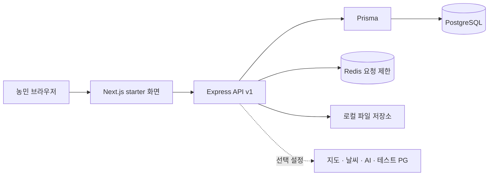
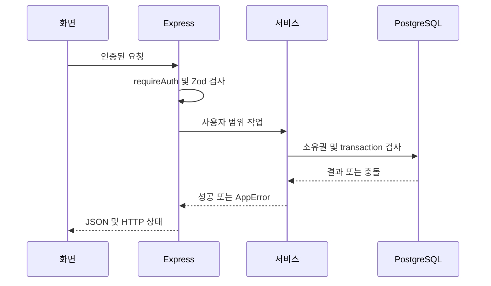
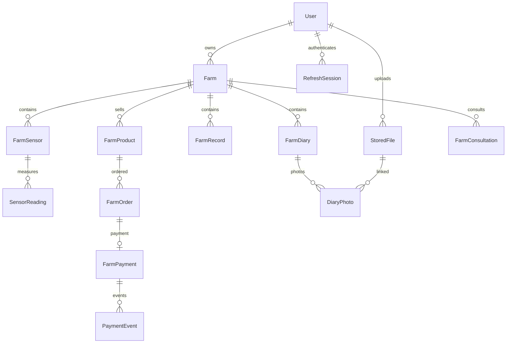
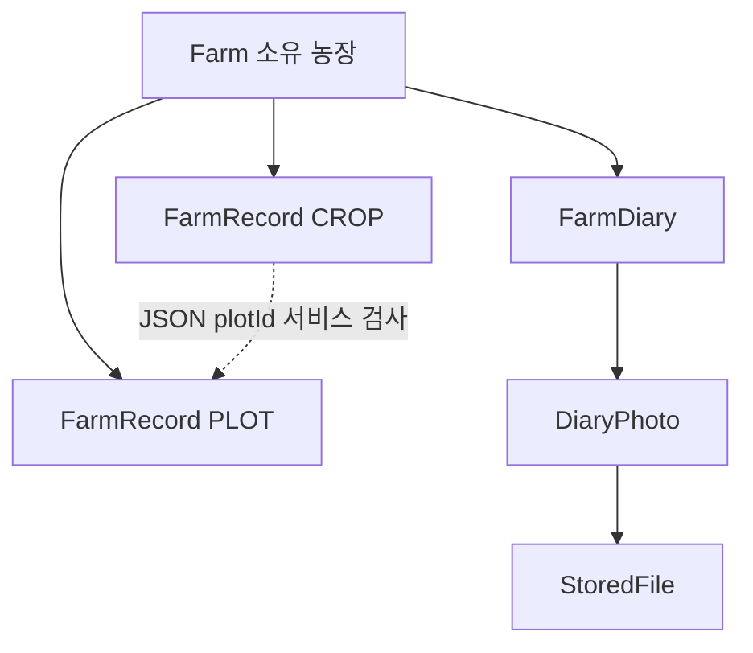
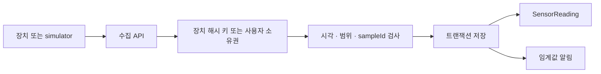
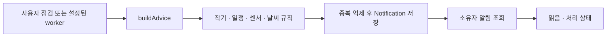
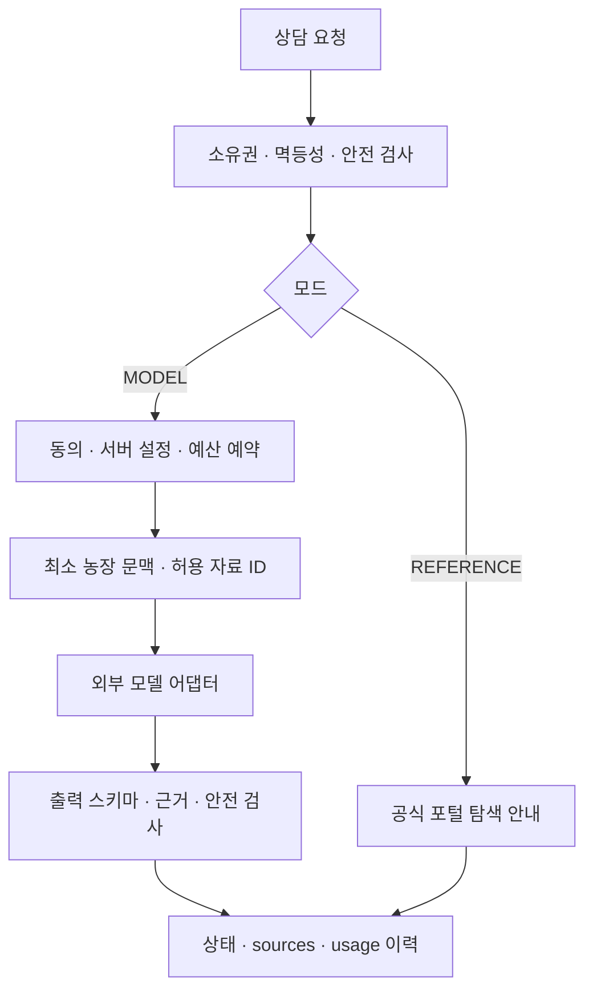
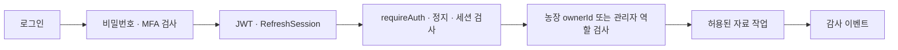
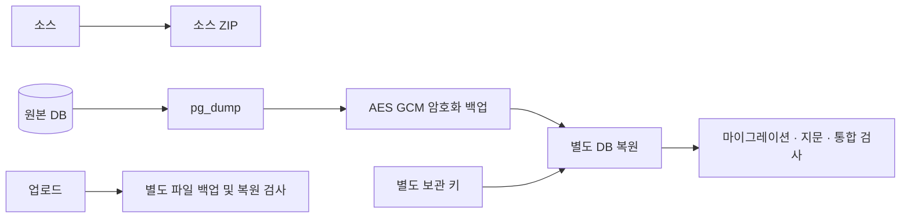
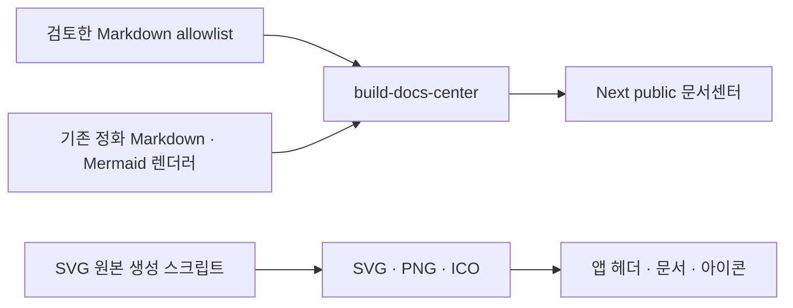

# 실제 코드로 보는 시스템 구조와 기능 흐름

기준일: 2026-10-30. 구현 파일의 존재와 운영 검증을 구분합니다. 최신 웹·별도 앱 범위는 [모바일 앱과 디자인](모바일앱과-디자인.md), 음성·협업·장애 검증은 [6차 결과](6차-음성과-실행복구.md)를 함께 읽으세요.

## 전체 아키텍처와 프론트·백엔드 연결

## API 요청·응답

## 주요 DB 관계

## 농장·필지·작기·일지

일지는 농장에 연결되며 작기와 직접 SQL 외래키로 연결된 것은 아닙니다.

## 센서 데이터 처리

## 알림 생성·전달

외부 SMS·앱 푸시 발송을 구현한 흐름이 아닙니다.

## AI 상담·분석

농장 추천은 별도 규칙 엔진입니다. 생성형 모델이 물리 장치를 제어하지 않습니다.

## 인증·권한

## 백업·복원

## 문서·브랜드 빌드

연결 근거: bootstrap/app.ts, operations.service.ts, consultation.controller.ts, assistant.worker.ts, prisma/schema.prisma, tools/verify-farm-postgres.mjs. 전체 세부 모델과 필드는 API·데이터 목록을 함께 읽습니다.

[문서센터](../README.md) · [기능 설명](기능-설명.md) · [개발현황](../CT-Farm-개발현황.md)
